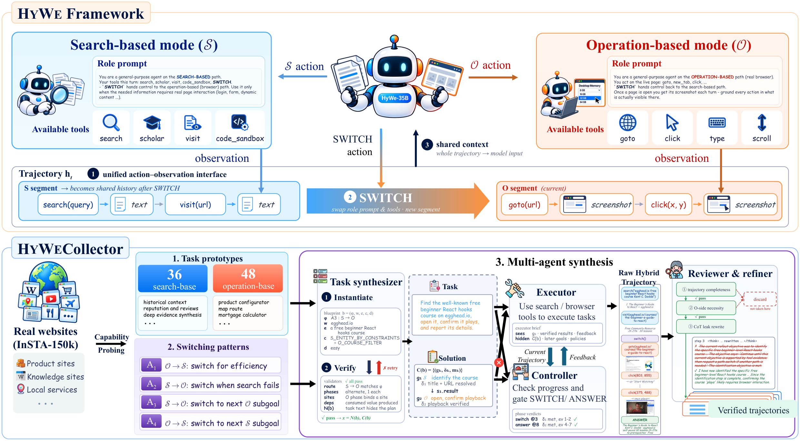

<h1 align="center">HyWe</h1>
<p align="center"><strong>Unifying Search and Operation for Real-World Hybrid Web Tasks</strong></p>

<p align="center">
  <a href="https://huggingface.co/yzxjb/HyWe-35B"></a>
  <a href="https://huggingface.co/datasets/yzxjb/HyWeBench"></a>
  <br>
  <a href="https://huggingface.co/datasets/yzxjb/HyWe-Hybrid-SFT-Data"></a>
  <a href="https://huggingface.co/datasets/yzxjb/HyWe-Search-SFT-Data"></a>
</p>

HyWe combines search tools and browser operation in one agent. The agent uses
`switch` to change its tool interface and rebuild context while retaining its
execution history. This release contains the inference framework,
**HyWeCollector** data pipeline, **HyWeBench** tasks and checklist evaluator,
and adapters for the operation and deep-search benchmarks used in the paper.

**HyWe-35B** is fine-tuned from Qwen3.6-35B-A3B. Screenshots use a
1280×720 viewport and the model uses
coordinates on a 0–1000 grid. Kimi endpoints are adapted to their 0–1 convention.

## Overview

[](assets/overview.pdf)

*The paper's overview of the HyWe framework and HyWeCollector pipeline.
Click the image to open the original vector PDF.*

## Quick start

Python 3.10+ and Chromium are required. Run these commands from the repository root:

```bash
python -m venv .venv
source .venv/bin/activate
pip install -r requirements.txt
playwright install chromium
# Linux hosts missing Chromium system libraries: playwright install --with-deps chromium
cp configs/hywe.env.example configs/hywe.env
# Edit configs/hywe.env: set the policy/summarizer endpoints and your Jina/Serper keys.
source configs/hywe.env
```

The policy needs a vision-capable, OpenAI-compatible chat endpoint. To host the
released weights with vLLM, install `requirements-serve.txt` in a separate serving
environment, then run:

```bash
vllm serve yzxjb/HyWe-35B --served-model-name HyWe-35B \
  --host 127.0.0.1 --port 8000 --tensor-parallel-size 2 --max-model-len 224000
```

Adjust GPU count and concurrency to your available memory. The BF16 checkpoint
is approximately 70.2 GB before KV cache. The release does not require GPU
inference locally if you supply an endpoint. See [INSTALL.md](INSTALL.md) for
configuration, serving, and troubleshooting.

Start the optional code tool in another terminal:

```bash
python tools/local_sandbox/server.py --host 127.0.0.1 --port 8080
```

It executes subprocesses as your current user; use it only on your own trusted
development machine. An existing SandboxFusion-compatible `/run_code` service
can be substituted with `CODE_SANDBOX_BASE_URL`.

Run a task or the full hybrid benchmark:

```bash
bash scripts/run_hywe.sh examples/task.jsonl runs/example operation
bash scripts/run_hywe.sh benchmarks/hywebench/hywebench_100.jsonl runs/hywebench operation
```

`web` controls the starting mode: a non-empty URL starts browser operation;
otherwise the task starts in search mode. `operation`/`search` above selects
the step budget (100/300), not the starting mode. Each task produces
`<run>/<task_id>/result.json`, `meta.json`, and its screenshot trajectory.
The runner resumes completed tasks and retries unfinished infrastructure failures;
it exits unsuccessfully if its retry rounds finish with tasks still incomplete.

## Evaluation

🤗 **[HyWeBench on Hugging Face](https://huggingface.co/datasets/yzxjb/HyWeBench)**
contains the 100 evaluation tasks and their fixed checklists: 309 information
items and 247 operation items. The same task file ships in
`benchmarks/hywebench/`; see the [benchmark guide](benchmarks/hywebench/README.md)
for the dataset schema and download options.

Recompute all published HyWeBench task/subgoal metrics without any model calls:

```bash
python evaluation/hywebench/score.py evaluation/hywebench/paper_verdicts/*.jsonl
```

| Agent | Task success | Information subgoals | Operation subgoals |
| --- | ---: | ---: | ---: |
| Qwen3.6-35B-A3B base | 28.0 | 74.8 | 43.7 |
| HyWe-35B | **47.0** | **82.2** | **68.8** |

These are aggregations of the archived judge outputs, not new live-site runs.
All 100 benchmark tasks, their fixed checklists, and 14 sets of verdicts are
included. New trajectories require a vision-capable judge:

```bash
# Set JUDGE_BASE_URL / JUDGE_API_KEY / JUDGE_MODEL (paper: kimi-k3).
bash evaluation/hywebench/judge.sh runs/hywebench
```

For other benchmarks:

| Benchmark | Prepare tasks | Run profile | Judge entry point |
| --- | --- | --- | --- |
| WebVoyager (643) | Included in `benchmarks/webvoyager/` | `operation` | `evaluation/webvoyager/judge.sh` |
| Online-Mind2Web (300) | `python benchmarks/prepare_benchmarks.py online_mind2web` | `operation` | `evaluation/online_mind2web/judge.sh` |
| HLE test (2500, images included) | `python benchmarks/prepare_benchmarks.py hle` | `search` | `evaluation/search/judge.sh` |
| xbench-DeepSearch-2510 (100) | `python benchmarks/prepare_benchmarks.py xbench` | `search` | `evaluation/search/judge.sh` |
| BrowseComp-EN (1266) | `python benchmarks/prepare_benchmarks.py browsecomp` | `search` | `evaluation/search/judge.sh` |

Accept the source dataset terms and set `HF_TOKEN` for the gated datasets.
Converted tasks are kept in git-ignored `benchmarks/data/`. Operation judges
use `OPENAI_API_KEY` and optional `OPENAI_BASE_URL`; their default models are
`M2W_JUDGE_MODEL=o4-mini` and `WV_JUDGE_MODEL=gpt-4o`, independently of the policy
`MODEL`. Search judging uses five votes at temperature 0.6 and majority voting,
with exact matches accepted directly. See [evaluation/README.md](evaluation/README.md).

## Collect data and export SFT samples

The recommended model for every collection role is **kimi-k3**. Override
individual roles in the example config to use a different executor, controller,
or reviewer. Jina embeddings are a separate API used for semantic pairing.

```bash
cp configs/collector.env.example configs/collector.env
# Fill in COLLECTOR_BASE_URL / COLLECTOR_API_KEY and the web-tool keys.
source configs/collector.env

# Probe a few sites first; use LIMIT=0 for the entire shipped site pool.
LIMIT=5 bash collector/scripts/stage1_capability_probing.sh
TAG=demo COUNT=20 bash collector/scripts/stage2_task_design.sh
TAG=demo bash collector/scripts/stage3_teacher_rollout.sh
TAG=demo bash collector/scripts/stage4_review_refine.sh
TAGS=demo bash training/build_sft_data.sh
```

The stages cover capability probing, blueprint/task synthesis, coordinated
teacher execution, and review/refinement. Export uses the inference renderer to
produce segment-wise multi-turn samples with assistant loss masks and portable
images. Stage 1 records the facts from which the shipped prototype catalog was
abstracted; Stage 2 uses that curated catalog rather than automatically rewriting
it from a new probe run. See [collector/README.md](collector/README.md) and
[training/README.md](training/README.md) for stage artifacts and the saved
training configuration.

## Paper-to-code map

| Component | Implementation |
| --- | --- |
| S/O tools, switching and runtime | `inference/hybrid_agent.py`, `hybrid_runtime.py`, `hybrid_*.py` |
| ReAct rendering and context folding | `inference/react_v2.py`, `react_v2_prompts.py` |
| Private teacher phase controller | `inference/teacher_phase_controller.py` |
| Capability probing | `collector/stage1_probe.py`, `explorer_agent_v8.py`, `fact_prober_v2.py` |
| Task blueprints and naturalization | `collector/hybrid_task_design_pipeline.py`, `hybrid_task_design.seed.json` |
| Review, refinement and filtering | `collector/audit_trajectory_unified.py`, `collector/scripts/stage4_review_refine.sh` |
| Segment export and loss masks | `training/build_hybrid_teacher_v2.py`, `training/build_sft_data.sh` |
| HyWeBench fixed checklists and judge | `benchmarks/hywebench/`, `evaluation/hywebench/` |

## Reproducibility and validation

The release uses direct provider APIs, inline screenshots by default, and
configurable endpoints. It does not ship the original machine's key-rotation
services, tunnels, private gateways, or training-cluster paths.

The archived evaluation launchers used **Jina Search**, while the paper appendix
describes **Serper** for `search`. `configs/hywe.env.example` follows the archived
runs with `HYBRID_SEARCH_BACKEND=jina`; select `serper` to follow the appendix
description. Collection defaults to Serper. `scholar` uses Serper in both cases.
This discrepancy and the limits of live-web reproduction are documented in
[docs/REPRODUCIBILITY.md](docs/REPRODUCIBILITY.md).

```bash
pip install -r requirements-dev.txt
python -m pytest -q
python scripts/check_release.py
python scripts/smoke_test.py        # local scripted model + real Chromium; no API keys
```

The smoke test verifies integration with deterministic scripted responses. It
does not measure agent task-solving ability. Live sites and hosted models change;
rerunning a workflow does not guarantee the same historical success rates.

## License and attribution

Original release code is licensed under [Apache-2.0](LICENSE). Adapted and
vendored material retains its upstream terms; see
[THIRD_PARTY_NOTICES.md](THIRD_PARTY_NOTICES.md) and `LICENSES/`.
Third-party benchmarks and model weights follow their respective source terms.
