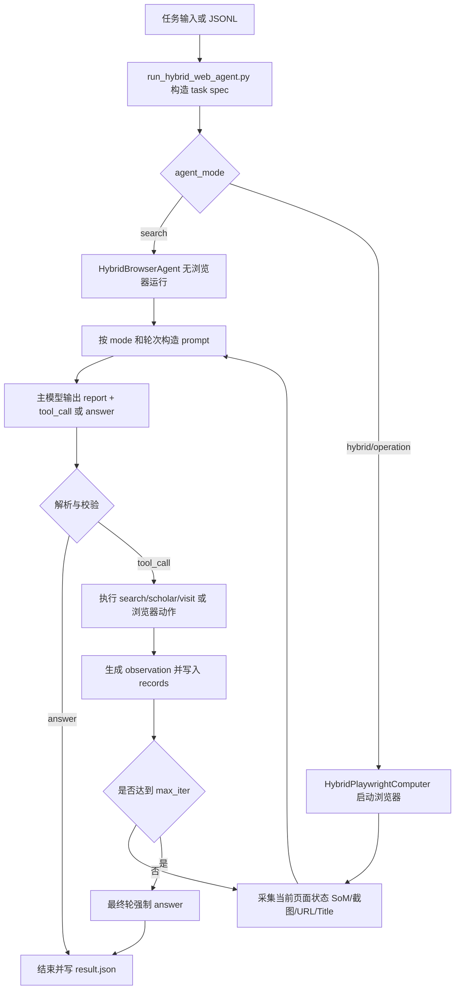

# HybridWebAgent 工作流与核心思想

本文档基于 `/data/czj/HybridWebAgent` 当前代码实现整理，重点说明这个项目的整体工作流、主要设计思想、核心模块分工，以及 `hybrid / operation / search` 三种运行模式的差异。

## 1. 项目一句话概括

`HybridWebAgent` 本质上是在做一件事：

- 下层沿用 `Mobile-Agent-v3.5/browser_use` 的浏览器执行与 SoM 标注能力
- 上层采用 `IterResearch` 风格的“每轮写 report、按需重建上下文”的决策方式
- 中间再补上 `search / scholar / visit` 这类信息工具，专门处理“缺信息”而不是“缺交互”的情况

因此它不是纯搜索 agent，也不是纯网页操作 agent，而是一个面向混合 Web 任务的通用 agent 框架。

## 2. 核心思想

### 2.1 双层架构

这个项目把“决策”和“执行”拆成了两层：

- 上层是 `HybridBrowserAgent`
  - 决定当前到底缺什么
  - 组织 prompt
  - 调 LLM
  - 解析结构化输出
  - 分派工具
- 下层是 `HybridPlaywrightComputer`
  - 真正打开浏览器
  - 截图
  - 生成 SoM 标注
  - 执行 `goto / click / fill / select / scroll / wait / go_back`

这意味着项目并不把“会思考”和“会点网页”混成一团，而是明确让 controller 负责策略，让 runtime 负责动作。

### 2.2 瓶颈驱动，而不是任务类型驱动

项目要求模型在每一轮都先判断当前瓶颈是什么：

- `missing_information`
- `missing_interaction`
- `completed`

然后再决定下一步用什么工具。

这和传统“先把任务分成信息类 / 操作类，再固定走某条链路”的思路不一样。它更强调动态判断：

- 如果缺信息，就优先 `search / scholar / visit`
- 如果缺页面状态变化，就优先 `goto / click / fill / select / scroll / wait / go_back`
- 如果目标已经完成，就直接输出答案

这个设计使它更适合“先找页面，再进入页面，再交互，再抽取答案”的混合任务。

### 2.3 上下文重建，而不是全历史回放

项目的一个关键思想是：下一轮 prompt 不会无脑塞入全部历史，而是只保留最关键的结构化状态：

- 当前日期
- 当前任务
- 上一轮 `report`
- 上一轮 `observation`
- 最近若干次工具调用
- 当前浏览器 URL / Title
- 当前截图
- 当前 SoM 文本

也就是说，它依赖“上一轮的结构化总结 + 当前页面状态”，而不是把完整消息历史不断累加。这是典型的 `IterResearch` 风格：让模型每轮重新审视当前瓶颈，而不是背着整段长对话硬推。

### 2.4 信息读取和浏览器交互解耦

这个项目明确区分两种行为：

- `visit`
  - 用来“读页面内容”
  - 走 reader-style 获取文本或 PDF 内容
  - 不改变当前浏览器状态
- `goto / click / fill / select / scroll / wait / go_back`
  - 用来“操作浏览器页面”
  - 会改变页面状态、截图、SoM 和后续可交互元素

这套边界非常重要：

- 想快速抽取页面信息，不必真的把页面切到浏览器里
- 想继续点击、输入、滚动，就必须把页面 `goto` 到浏览器里

因此 `visit` 是“读”，`goto` 和操作工具是“进页面并操作”。

### 2.5 强制结构化输出

主模型每一轮都必须输出：

```text
<report>...</report>
```

然后二选一：

```text
<tool_call>...</tool_call>
```

或

```text
<answer>...</answer>
```

这个约束带来几个直接好处：

- 每一步都留下显式中间思路摘要
- 工具调用容易校验和回放
- 到了最后一步可以强制模型停止调用工具，直接给出答案

### 2.6 两个模型角色可以分离

当前实现里通常有两个模型角色：

- 主模型
  - 负责逐轮决策与工具选择
- 总结模型
  - 负责 `visit` 后的网页内容摘要

这样可以把“页面阅读摘要”与“agent 决策”拆开，降低主模型上下文压力，也便于做不同模型组合实验。

## 3. 核心模块分工

| 文件 | 作用 |
| --- | --- |
| `run_hybrid_web_agent.py` | CLI 入口，解析参数、构造任务、调度运行、落盘结果 |
| `hybrid_agent.py` | 主 controller，负责 prompt、LLM 调用、响应解析、工具校验、执行分派 |
| `hybrid_runtime.py` | Playwright 运行时，负责浏览器生命周期、截图、SoM 生成、网页动作执行 |
| `hybrid_prompts.py` | 系统提示词、三种 mode 的工具集合、首轮/普通轮/最终轮模板 |
| `hybrid_visit.py` | `visit` 工具，负责读取网页或 PDF，再交给总结模型抽取证据 |
| `hybrid_search.py` | `search` 工具，负责调用 Serper 风格搜索接口 |
| `hybrid_scholar.py` | `scholar` 工具，负责学术搜索、论文元信息和 PDF 链接发现 |
| `hybrid_utils.py` | URL 规范化、标签提取、文本截断、JSONL 读写、task_id 清洗等通用函数 |

## 4. 端到端工作流

下面按真实执行路径说明。

### 4.1 入口阶段

入口脚本是 `run_hybrid_web_agent.py`。

它会完成这些事情：

1. 解析 CLI 参数
2. 读取主模型和总结模型的地址、模型名、API Key
3. 读取运行配置
   - `agent_mode`
   - `max_iter`
   - `headless`
   - 代理
   - SoM 与截图相关参数
4. 支持两种输入方式
   - 单任务：`--task`
   - 数据集：`--input-path` 指向 JSONL
5. 统一构造成 `task spec`
6. 为每个任务创建输出目录并保存 `meta.json`

如果是 `operation` 模式且用户没有提供起始页面，代码会默认把起点设成 `https://www.google.com/`，保证浏览器操作模式一开始就有可用页面。

### 4.2 运行模式分流

项目有三种 mode：

### `hybrid`

- 允许全部工具
- 既能读网页，也能操作浏览器
- 如果首轮没有给初始 URL，第一轮会按“没有当前页面”的 prompt 去规划

### `operation`

- 只允许浏览器操作工具
- 不允许 `search / scholar / visit`
- 更像纯网页执行 agent

### `search`

- 只允许 `search / scholar / visit`
- 不启动可交互浏览器工作流
- `visit` 必须显式提供 URL，因为没有当前浏览器状态可继承

### 4.3 浏览器初始化

只要不是 `search` 模式，就会进入 `HybridPlaywrightComputer`：

- 启动 Chromium
- 创建 context
- 设置 viewport、UA、locale、timezone
- 可选复用 storage state
- 根据 `web` 或 mode 打开初始 URL
- 监听新页面并把新标签页重定向回主页面

之后 controller 在每一轮按需向 runtime 请求当前页面状态。

### 4.4 每一轮的状态采集

如果当前轮有可用页面，runtime 会调用 `current_state(step)` 生成：

- 当前 URL
- 当前标题
- SoM 截图
- 无框原始截图
- SoM 列表
- 格式化后的 SoM 文本

这些状态会写到任务目录，例如：

- `trajectory_som/screenshot{step}.png`
- `trajectory/{step}_full_screenshot.png`

如果页面 SoM 生成失败，代码仍会尽量保留普通截图。

### 4.5 Prompt 组装

`HybridBrowserAgent` 会根据当前 mode 和轮次选择不同 prompt 模板：

- 首轮 / 中间轮 / 最终轮
- 有浏览器页面 / 无浏览器页面
- hybrid / operation / search

送给模型的内容通常包括：

- task
- previous report
- previous observation
- recent actions
- current URL
- current title
- current SoM 文本
- 当前截图
- 输入图片
- 上一轮 `visit` 额外抓到的页面截图

注意这里有个重要细节：

- `visit` 不会改变浏览器页面
- 但如果本轮执行过 `visit`，agent 会尝试额外抓取该访问页面的截图
- 这张截图会在下一轮作为补充证据附给主模型
- 同时明确声明它“不代表浏览器状态发生切换”

### 4.6 主模型决策

主模型收到 prompt 后，必须先给出 `<report>`，再给出 `<tool_call>` 或 `<answer>`。

`report` 里被要求显式包含：

- 当前网页与已有信息的综合判断
- 当前进展总结
- 当前瓶颈判断
- 下一步工具计划

这个阶段的本质不是“直接让模型猜你想要什么动作”，而是先要求模型说明：

- 现在页面提供了什么
- 之前已经拿到了什么
- 当前真正缺的是信息还是交互

然后才进入动作选择。

### 4.7 响应解析与格式纠正

controller 会对模型响应做严格校验：

- 是否存在 `<report>`
- 是否在 `<tool_call>` 和 `<answer>` 中二选一
- `tool_call` 是否是合法 JSON
- 工具名是否合法
- 参数是否合法
- 当前 mode 是否允许这个工具

如果格式不对，会把“FORMAT ERROR”作为新的 user message 追加回去，让模型重生成；默认可重试多次。

这一步是整个项目能稳定跑起来的关键，因为它把“结构化输出约束”真正落实到了控制逻辑里，而不是只靠 prompt 祈祷模型听话。

### 4.8 工具执行

当 `tool_call` 校验通过后，controller 会分派给对应工具。

### 信息工具

- `search`
  - 用于找候选网站、候选页面、外部证据
- `scholar`
  - 用于学术搜索、论文结果和 PDF 链接发现
- `visit`
  - 用于读取一个或多个页面或 PDF
  - 优先走 Jina Reader 风格路径
  - 必要时退回直接请求
  - 对 PDF 可走单独下载与解析逻辑
  - 会按 tokenizer 和字符上限截断内容
  - 再调用总结模型，把结果压缩成 `Evidence in page` + `Summary`

### 浏览器工具

- `goto`
  - 直接在浏览器里打开 URL
- `click`
  - 点击 SoM 标号对应元素
- `fill`
  - 向输入框写入文本，可选回车提交
- `select`
  - 选择下拉项
- `scroll`
  - 支持滚动 `WINDOW` 或指定 SoM 区域
- `wait`
  - 等待页面状态变化
- `go_back`
  - 浏览器回退

### 4.9 SoM 标签校验

项目对浏览器动作不是“想点哪里就点哪里”，而是显式依赖 SoM 数字标签。

这意味着：

- `click / fill / select / scroll(label)` 必须使用当前页面可见的数字 label
- 不允许直接把按钮文字当 label 传进去
- label 超出当前 SoM 范围会被判为无效

这一步的作用是把模型输出和当前页面可见元素绑定起来，减少“凭空点击一个并不存在的控件”这种错误。

### 4.10 观察结果回写

每执行一次工具，都会生成 observation，并写回 agent 内部状态：

- `last_report`
- `last_observation`
- `records`

如果执行的是 `visit`，还会额外记录：

- `summary_trace`
- `visit_screenshot_path`
- `visit_screenshot_url`

也就是说，整个系统不是只保存最终答案，而是保留了完整的逐步轨迹。

### 4.11 下一轮循环或最终回答

之后系统进入下一轮，重新做：

1. 采集当前状态
2. 重建 prompt
3. 重新判断瓶颈
4. 再选择工具或回答

直到发生以下终止条件之一：

- 模型直接输出 `<answer>`
- 达到 `max_iter`
- 多次格式纠正仍失败

如果走到最后一轮，prompt 会强制模型：

- 不再允许调用工具
- 必须给出 `<answer>`
- 明确说明已经完成的部分和仍未完成的部分

这使项目即使没完全完成任务，也能产出“最好的一次最终回答”，而不是无穷循环。

### 4.12 结果落盘

每个任务执行结束后会落盘：

- `meta.json`
  - 记录任务、模型、mode、尝试次数等元信息
- `result.json`
  - 记录最终答案、termination、records、token usage
- 过程截图目录
  - `trajectory_som/`
  - `trajectory/`
  - `visit_screenshots/`

同时项目还会把每个任务的摘要结果 append 到统一的 `results.jsonl` 里，方便批量评测。

## 5. 关键设计边界

这里总结一些最容易误解的边界。

### `visit` 不是 `goto`

- `visit` 负责“读”
- `goto` 负责“进浏览器并切页”

如果后面还要点、填、滚，就必须 `goto`，不能以为 `visit` 之后浏览器已经到了那个页面。

### `search` 和 `scholar` 只是线索发现器

它们擅长：

- 发现候选来源
- 快速拿到摘要
- 帮模型找下一步该访问哪个 URL

但如果需要更可靠的页面内容，通常还要进一步 `visit` 或 `goto`。

### SoM 是浏览器操作的地基

这个框架里真正的页面交互不是靠文本匹配，而是靠：

- SoM 截图
- SoM 文本
- SoM 数字标号

所以浏览器操作的稳定性很大程度上依赖 SoM 标注质量。

### 最终回答是强制收口的

项目不是把“是否回答”完全交给模型自由发挥，而是通过最终轮 prompt 强制收口。这对长链任务很重要，因为它能避免 agent 一直想继续搜、继续点。

## 6. 用一张图看完整流程



## 7. 三种模式的适用场景

### `hybrid`

适合：

- 既要找资料又要点页面
- 既要找目标 URL，又要进入页面完成交互
- 想验证“信息工具 + 浏览器工具”联合是否更稳

### `operation`

适合：

- 做纯网页操作消融
- 检查任务是否主要受浏览器执行能力限制
- 比较“没有 search/visit 时”的表现

### `search`

适合：

- 做纯检索/阅读消融
- 检查任务是否其实不需要浏览器交互
- 批量跑信息抽取类任务

## 8. 这个项目目前最有价值的地方

- 它把“信息收集”和“页面操作”放进了同一个 agent 回路
- 它不是靠堆满历史上下文，而是靠每轮 report 重建上下文
- 它给浏览器动作加了 SoM 约束，降低无效操作
- 它把 `visit` 设计成和浏览器页面解耦的读取工具，速度和灵活性都更好
- 它允许主模型和摘要模型分离，便于做实验
- 它把中间轨迹、截图、观测、摘要 trace 都保留下来了，方便分析失败原因

## 9. 当前实现上的注意点

从当前代码看，有几件事需要特别说明：

- `visit` 当前主链路已经稳定支持网页文本和 PDF 摘要
- `visit` 模块里保留了图片抽取与 data URL 处理辅助函数，但当前主执行路径仍以文本/PDF 摘要为主
- `search` 模式下没有浏览器当前页面，因此 `visit` 必须显式给 URL
- `operation` 模式会默认给一个起始页，避免一开始没有可交互页面
- 这个项目强依赖外部 SoM 代码与外部服务
  - SoM 来自 `Mobile-Agent-v3.5/browser_use`
  - 搜索通常依赖 Serper 风格接口
  - `visit` 通常依赖 Jina Reader 风格接口或直接请求

## 10. 总结

如果只用一句话总结这个项目，可以写成：

`HybridWebAgent` 是一个“按当前瓶颈决定是去搜、去读，还是去点页面”的 Web Agent，其中浏览器执行借用了 `Mobile-Agent`，而长链路决策和上下文压缩借用了 `IterResearch`。

它最核心的价值不在于某个单独工具，而在于这套统一回路：

- 先判断缺什么
- 再选对工具
- 执行后写回 observation
- 用最新 report 和最新页面状态重建下一轮上下文

这就是它的主工作流，也是它和纯浏览器代理、纯搜索代理最大的区别。
